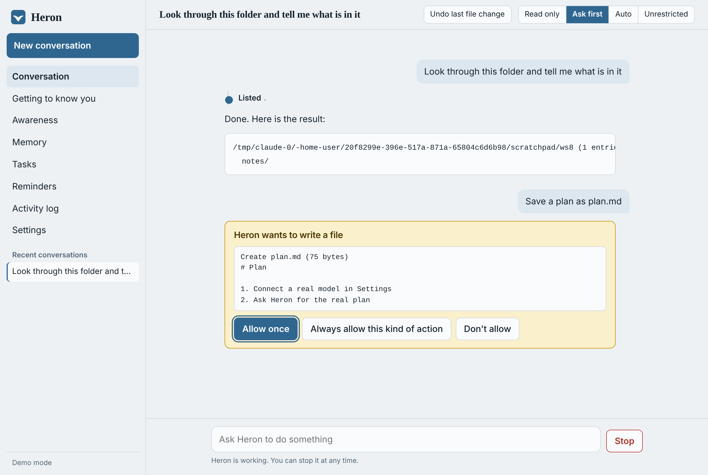

# Heron

[](https://github.com/fernandogarzaaa/HERON-Project/actions/workflows/ci.yml)

A personal AI agent that runs on your own computer. Desktop app for macOS and Windows (and Linux), plus a full command-line interface. Written in Rust.



Heron reads and writes files, runs commands, searches and reads the web, keeps long-term memory about you, manages your tasks, and runs reminders and recurring jobs on a schedule — with every action gated by a permission system and recorded in an audit log.

## What makes it different

| | |
|---|---|
| **Local-first** | One process, one SQLite file in `~/.heron`. No account, no telemetry, no server. The only data that leaves your machine is what you send to the model you choose. |
| **Any model** | Works with any OpenAI-compatible endpoint: OpenRouter, OpenAI, or a model running entirely on your machine (Ollama, LM Studio). Automatic retry and fallback models. |
| **Memory that works offline** | Hybrid retrieval (SQLite FTS5 keyword search + vector similarity, fused and weighted by importance and recency). Embeddings are computed locally with no API call; a remote embedding model is optional. Near-duplicates are merged, and credentials are redacted before anything is stored. |
| **Safety you can reason about** | Every tool call is classified (safe / network / write / exec / dangerous / forbidden) and checked against the permission mode and your allow/deny rules. Catastrophic commands are blocked in every mode. File writes are checkpointed and undoable. Fetches cannot reach localhost or your LAN. |
| **Outside content restricts what happens next** | Telling a model to ignore instructions hidden in a web page or email is known not to be reliable, so Heron does not rely on it. Once such content has entered a conversation, anything that changes state — and any fetch that could carry data out in its address — needs your approval, whatever the mode or your allow rules say; unattended runs simply refuse. The restriction follows sub-agents and survives reopening the conversation. |
| **Commands run in a sandbox** | On Linux (bubblewrap) and macOS (Seatbelt), every command the agent runs is confined by the operating system: it can change files only in your working folder and temporary folders, and cannot read Heron's own data or your `.ssh`, `.aws` and similar folders, whatever the command line says. Builds, tests, git and the network work as usual. |
| **It cannot quietly reconfigure itself** | Writes to Heron's own folder (settings, permission rules, skills, memory, keys) always need your approval. Saving a skill always shows you the full text first. Tools from connected apps are fingerprinted when you first connect them; if an app later changes its tool descriptions, every use needs approval until you accept the change. |
| **Memory you can inspect and trust** | Facts are never overwritten: a corrected fact retires the old version, which is kept as history and no longer recalled. Facts picked up from email, calendar, documents or observation are marked unconfirmed, never become part of your profile, cannot replace something you said, and wait for your confirmation under Memory. |
| **Keys in the OS credential store** | API keys, the email app password, calendar links and the Telegram token go to the macOS Keychain or Windows Credential Manager (an owner-only file on Linux). Never the config file, database, logs, or the environment of commands it runs. |
| **From your phone** | Connect a Telegram bot and talk to Heron while your computer is on. It answers exactly one chat — the one that sent the pairing code shown in the app. Permission questions arrive as yes/no; risky actions can only be approved at the computer; `/stop` halts it. Results of scheduled work are forwarded. |
| **Spending is capped** | Work Heron starts on its own (suggestions, preparing, taking over, reflection) has a daily token allowance (150,000 by default). Reminders you scheduled always run. |
| **You can see what it did** | Each action appears on a track beside the reply, and in a permanent activity log. |
| **Extensible** | Connect any MCP server to add tools; drop Markdown files in `~/.heron/skills` to teach procedures; Heron can also *serve* its memory and tasks to other MCP apps. |
| **Aware in the background** | While it is open, Heron watches your working folder and keeps a local journal (file names and times only — never contents, never secrets). From it Heron knows what you changed recently, your focus areas this week, your git branch and your usual hours, so "pick up where I left off" just works. Optionally it reflects on what it saw a few times a day and remembers the conclusions. Everything is visible, pausable and erasable on the Awareness page. It also learns from conversations: facts about you and *how* you like recurring tasks done. |
| **Gets to know you first** | On first launch Heron walks you through onboarding: tell it about yourself, let it look around this computer, and connect your notes, calendar (any private ICS link) and email (read-only IMAP with an app password). Everything is indexed locally so the agent can look things up; a separate "Learn from it" step, which you trigger, sends excerpts to your model to extract lasting facts about people, projects and commitments. Any source can be disconnected, which also forgets everything indexed and learned from it. |
| **A personality you own** | How Heron behaves and speaks lives in one plain file, written as behaviours ("lead with the answer", "no closing offers") rather than adjectives. Edit it in Settings, or just say "be more casual" in a conversation: Heron proposes the change and you approve it. One click puts it back. |
| **Nothing is lost while you are away** | When unattended work (a reminder, a watch, a take-over) reaches a step that needs your approval, Heron does not do it and does not give up: the step waits in a "Waiting for you" list, the rest of the job carries on, and you can run exactly that step later with one click. |
| **Automations that do not need the AI every time** | Ask Heron to "automate" a recurring job and it builds a list of fixed steps — fetch a page, check a condition, loop over files, tell you — shows you the outline, and saves it once you approve. From then on the steps run as plain code through the same permission checks as everything else; the AI model is called only by steps that need judgment. A job that would otherwise cost tokens every morning costs nothing, and does the same thing every time. Each run is recorded step by step, and you can run one on demand. |
| **Reacts to events, not just the clock** | Besides times ("daily 08:00"), jobs can fire when something happens: "when notes/*.md changes", "when an email arrives from Maria". Mail that sets off a job is outside content, so such a job can prepare and report but cannot act without you. Watches can be told to speak up only when something needs you. |
| **Today at a glance** | The home screen shows what needs you today — calendar, due and overdue tasks, new mail, things waiting for approval — assembled locally with no AI model involved, with a one-click "Prep my day". |
| **Per-ability switches and a kill switch** | Each ability can be set to ask as usual, never ask, or never allow. One switch (or `/pause` from your phone) stops everything Heron does on its own. |
| **A log that cannot be quietly edited** | The activity log is append-only at the database level and every entry is hash-chained to the one before, so any alteration or removal is detected (`heron audit`). |
| **Proactive, at the level you choose** | Heron uses what it has noticed and learned to offer work it could take off your hands. Four levels: only when asked (default) · suggest · prepare ahead (read-only groundwork, waiting for you) · take over (it does the work itself, limited to creating and editing files in your folder; no commands, nothing outside the folder, nothing risky; every change undoable from its own conversation). Declined offers teach it what not to suggest, and raise the bar for the next one; it waits for a lull rather than interrupting you mid-task; staying silent is a valid outcome. |
| **Try it with no key** | Demo mode (`base_url = "demo"`, or "Try the demo first" in the app) gives canned replies but performs real actions, so you can try approvals, memory and reminders before connecting a model. |
| **Scheduling built in** | "Remind me tomorrow at 9", "every 2h", or cron. Unattended runs are read-only by default; you can grant a single job more (edit files, run commands) when you create it. The agent can never grant itself authority, and risky actions are always refused when nobody is there to approve them. |

## Install

Heron v0.1.0 is a beta. Download from the [releases page](https://github.com/fernandogarzaaa/HERON-Project/releases), or use the one-line installer for your system. The installers check the download against the published checksums before installing anything.

**macOS** (Apple silicon and Intel, macOS 11 or later)

```bash
curl -fsSL https://raw.githubusercontent.com/fernandogarzaaa/HERON-Project/v0.1.0/scripts/install.sh | sh
```

Or download `Heron-macos-universal.dmg`, open it, and drag Heron onto Applications.

**Windows** (10 or 11, 64-bit)

```powershell
irm https://raw.githubusercontent.com/fernandogarzaaa/HERON-Project/v0.1.0/scripts/install.ps1 | iex
```

Or download `Heron-Setup-windows-x64.exe` and run it (no administrator rights needed), or unzip `Heron-windows-x64.zip` anywhere and open `Heron.exe`.

**Linux** (64-bit, needs WebKitGTK 4.1)

```bash
curl -fsSL https://raw.githubusercontent.com/fernandogarzaaa/HERON-Project/v0.1.0/scripts/install.sh | sh
```

Then open Heron. The first launch walks you through getting set up: choose an AI model (or try the built-in demo, which needs no key), tell Heron about yourself, and connect what you like.

Notes for this beta:
- The apps are not code-signed. If you downloaded the macOS disk image in a browser, the first launch needs right-click → Open. Windows SmartScreen shows "More info → Run anyway". The one-line installers avoid the macOS prompt.
- Windows needs the WebView2 runtime, which is part of Windows 11 and current Windows 10.
- Your data lives in the `.heron` folder in your home folder. Uninstalling Heron leaves it in place.
- To remove Heron: drag it out of Applications (macOS), use "Add or remove programs" or delete `%LOCALAPPDATA%\Programs\Heron` (Windows), or run `~/.local/share/heron/install.sh --uninstall` (Linux).

### Build from source

Needs [Rust](https://rustup.rs). On Linux also `libwebkit2gtk-4.1-dev` and `libgtk-3-dev`.

```bash
./packaging/macos/build-app.sh
```

```bash
powershell -ExecutionPolicy Bypass -File packaging\windows\build.ps1
```

```bash
./packaging/linux/build.sh
```

Command line only, on any system:

```bash
cargo install --path .
```

## Using it

```text
heron                     interactive chat in the current folder
heron -c                  continue the last conversation
heron run "summarize README.md"        one request, then exit (stdin is included if piped)
heron serve               the app in your browser + scheduler
heron daemon              scheduler only
heron doctor              check configuration and connectivity
heron eval                measure memory retrieval quality (offline, built-in test set)
heron memory | tasks | schedules | inbox | audit | sessions
heron mcp-serve           expose memory and tasks to other apps over MCP
```

Global flags: `-C <folder>` (working folder), `--mode readonly|ask|auto|yolo`, `--model <id>`.

In chat: `/help`, `/new`, `/resume <id>`, `/memory [query]`, `/forget <id>`, `/tasks`, `/schedules`, `/mode <m>`, `/undo`, `/tokens`, `/compact`. Ctrl-C stops a running reply.

## Permission modes

| Mode | Reads, searches, web | File changes in the working folder | Commands | Risky actions |
|---|---|---|---|---|
| `readonly` | allowed | refused | refused (read-only commands allowed) | refused |
| `ask` (default) | allowed | asks | asks (read-only commands allowed) | asks |
| `auto` | allowed | allowed | allowed | asks |
| `yolo` | allowed | allowed | allowed | allowed |

"Risky" means destructive or hard to undo (`rm -r`, `sudo`, `git push --force`, piping downloads into a shell…), touching credentials (`.ssh`, `.env`, key files), or writing outside the working folder. A small set of catastrophic commands (wiping the disk or home folder, formatting drives) is refused in every mode, including `yolo`.

"Always allow" answers become rules like `shell:cargo *`. Rules never cover risky actions. You can also write rules in the config:

```toml
[permissions]
allow = ["shell:git *", "shell:cargo *"]
deny  = ["shell:*curl*"]
```

## Automations

An automation is a job made of fixed steps. You normally get one by asking ("every morning, check this page and tell me if the tickets are back"), but the format is simple enough to read:

```json
[
  {"id": "page",  "do": "tool", "tool": "web_fetch", "args": {"url": "https://example.com/tickets"}, "retry": 1},
  {"id": "check", "do": "if", "condition": "{{ steps.page.out }} not contains \"sold out\"",
   "then": [{"id": "tell", "do": "notify", "title": "Tickets", "text": "They are back: {{ steps.page.out | lines | first }}"}]}
]
```

| Step | What it does |
|---|---|
| `tool` | Calls one of Heron's tools (files, commands, web, memory, tasks, connected apps), with optional `retry` |
| `ask` | One answer from the AI model, no tools |
| `agent` | A full agent run, for a step that needs both judgment and tools |
| `if` | Chooses between `then` and `else` steps |
| `for_each` | Repeats steps over a list (`{{ item }}`, `{{ index }}`), with a cap |
| `set`, `notify`, `stop` | Work out a value, tell you something, end the run |

Values pass between steps through templates such as `{{ steps.page.out | lines | limit(3) | join(", ") }}`, with `{{ trigger.event }}`, `{{ today }}`, `{{ now }}` and `{{ weekday }}` also available. Templates are deliberately not a programming language: dotted paths and a fixed list of filters (`lines`, `json`, `first`, `last`, `len`, `trim`, `lower`, `upper`, `join`, `limit`, `default`), with no code evaluation of any kind. A value that does not exist is an error, never a silent blank. Conditions support `contains`, `not contains`, `==`, `!=`, `>`, `<`, `>=`, `<=`, `is empty`, `is not empty`, joined with `and` / `or`.

Safety is the same as everywhere else in Heron: each tool step goes through the permission checks, a step that needs approval while you are away waits in "Waiting for you", content from the web or email restricts what later steps may do, and an automation cannot change Heron's own skills, personality or automations. The design is informed by workflow tools such as n8n (steps, branching, loops, retries, run history) but shares no code with them; there is no visual editor and no code step, by choice.

## Configuration

`~/.heron/config.toml` (create a commented starter with `heron init`; the desktop app edits it from Settings). Set `HERON_HOME` to move the data folder.

```toml
[llm]
base_url = "https://openrouter.ai/api/v1"
api_key_env = "OPENROUTER_API_KEY"
model = "anthropic/claude-sonnet-5.5"
fallback_models = ["openai/gpt-5.5"]
fast_model = "anthropic/claude-haiku-5.5"   # background work: summaries, learning

[mcp.servers.files]
command = "npx"
args = ["-y", "@modelcontextprotocol/server-filesystem", "/Users/me/Documents"]
```

The API key is read from the environment, or from the OS credential store when saved from the app (macOS Keychain, Windows Credential Manager; an owner-only `~/.heron/secrets.json` on Linux). It is never written to the config, the database, the logs, or passed to commands the agent runs.

### Skills

Put `~/.heron/skills/<name>.md` (or `<name>/SKILL.md`) with an optional first block:

```markdown
---
description: Write my weekly status update
---
1. Read notes/week.md ...
```

Only the name and description go in the prompt; the body is loaded when needed.

## Architecture

```text
src/
  agent.rs        agent loop: prompt assembly, streaming, tool gating, sub-agents, compaction
  llm.rs          OpenAI-compatible streaming client, retries, fallback
  memory.rs       hybrid retrieval, offline embeddings, dedupe, automatic learning
  permissions.rs  risk classification, modes, rules, path sandbox, SSRF guard, parked approvals
  sandbox.rs      operating-system sandbox for commands (bubblewrap, Seatbelt)
  persona.rs      the editable character file
  store.rs        SQLite: sessions, memory (FTS5), tasks, schedules, inbox, audit, checkpoints
  schedule.rs     cron + natural time expressions
  workflow.rs     automations: fixed steps, templates, conditions, run records
  sources.rs      onboarding and context sources: about-you, computer, documents, calendar, email, learning
  mail.rs         read-only IMAP client and message decoding
  telegram.rs     phone gateway with pairing, remote approvals and /stop
  eval.rs         built-in memory retrieval evaluation
  embed.rs        optional local neural embedder (feature `neural`)
  mcp.rs          MCP client and server (stdio)
  tools/          files, shell, web, memory/tasks/reminders/skills
  server.rs       local HTTP API + UI (loopback only, per-launch token)
  ambient.rs      background observer: activity journal and derived awareness
  app.rs          wiring, settings, scheduler, observer and reflection loops
  main.rs         CLI          bin/desktop.rs   native window (WebView2 / WKWebView / WebKitGTK)
assets/index.html the interface (single file, no external requests)
```

## Development

```bash
cargo test
```

```bash
cargo run --example mock_llm -- 8089
```

```bash
HERON_BASE_URL=http://127.0.0.1:8089/v1 HERON_API_KEY=x HERON_HOME=/tmp/heron-dev cargo run --features desktop --bin heron-desktop
```

The mock server is a tiny OpenAI-compatible endpoint that drives real tool calls, for working on the app without a model account. On Linux the desktop feature needs `libwebkit2gtk-4.1-dev` and `libgtk-3-dev`.

## Measured, not claimed

```bash
heron eval
```

runs a built-in, deterministic test of the memory retrieval layer: 30 facts, 34 questions worded differently from the facts (including misspellings), and 4 facts that later change.

| | Built-in (default) | With the neural model (`heron eval --neural`) |
|---|---|---|
| Right fact ranked first | 28 / 34 (82%) | 31 / 34 (91%) |
| Right fact in the top three | 30 / 34 (88%) | 33 / 34 (97%) |
| After a fact changed, current version ranked first | 4 / 4 | 4 / 4 |
| After a fact changed, retired version still recalled | 0 / 4 | 0 / 4 |

The built-in method needs nothing and tolerates misspellings, but misses questions that share no words with the answer ("what is her job" → "landscape architect"). The neural model (all-MiniLM-L6-v2, run locally; the approach comes from the ADAM project) fixes those but is not typo-tolerant on its own, so Heron fuses both with keyword search. It is an optional build feature (`cargo build --features desktop,neural`; on Linux this needs glibc 2.38 or newer, for example Ubuntu 24.04) and a switch in Settings; the model (about 23 MB) is downloaded once, on first use. The test suite fails if the default numbers regress. This measures retrieval only — not a model's reasoning, and not Heron against other agents.

Platform verification: every push runs the test suite and builds the desktop app on Linux, macOS and Windows machines (see the CI badge). Before that, the suite was run natively on Linux and as Windows executables under Wine.

## Known limits

- Commands run in an operating-system sandbox on Linux (when bubblewrap is installed) and macOS, but not on Windows. The sandbox limits where commands can write and hides Heron's data and your key folders; it does not restrict the network. Where there is no sandbox, risk classification of commands is pattern-based and should be treated as a convenience, not a boundary: the real protections there are approvals and the outside-content rule.
- The outside-content rule is per conversation and coarse: it does not track which specific data came from where, and files you downloaded and then ask Heron to read are not treated as outside content.
- The Telegram gateway was tested against a stand-in for Telegram's API, not the real service. Messages pass through Telegram's servers. It works only while Heron is running on your computer.
- No browser automation, voice, mobile app, email sending, calendar writing, or one-click OAuth connectors.

- Email is read-only IMAP with an app password (Gmail, iCloud, Fastmail, Yahoo). Outlook.com / Microsoft 365 require OAuth, which is not implemented. Only the 60 most recent inbox messages are indexed, as text excerpts.
- Calendar: repeating events are moved to their next occurrence for daily, weekly, monthly and yearly rules; multi-day patterns such as "every Tue and Thu" are approximated from the first occurrence, and other time zones are read as local time.
- Facts learned from email, calendar and documents come from content other people wrote. They are stored with lower importance than what you say directly and the extraction prompt treats the content as data, but a deliberately misleading email could still plant a wrong fact; review Memory from time to time.
- Proactive suggestions, "take over", reflection and learning need a real model and spend tokens; they are all off until you turn them on.

- Web search uses DuckDuckGo's HTML page, which can change or rate-limit.
- On Linux, saved keys are protected by file permissions only (no desktop keyring integration yet).
- Scheduled jobs run only while the app, `heron serve`, or `heron daemon` is running.
- No voice, no email/calendar integrations built in (add them through MCP servers).

## License

Apache-2.0. See [LICENSE](LICENSE).
