# Heron for Mac: visual direction

*   **Status:** Draft, waiting for the owner's approval of the choices in [Decisions](#decisions).
*   **Date:** 2026-11-18
*   **Supplements:** [`heron-v1.md`](heron-v1.md) §4 and work unit U4, as read at commit `cba31ab`. It adds no work units and changes no rule in that doc.
*   **Mockups:** [`heron-mac-visual/`](heron-mac-visual/index.html), static HTML. Open `index.html` in a browser. Screenshots are in `heron-mac-visual/shots/`.

## Overview

U4 builds Heron's SwiftUI Mac app. §4 of the v1 doc fixes what the app does. It leaves some visual and product choices to the U4 agent (M24): the navigation, the theme list, the `avatarStyle` and `accentColor` values, what "Prep my day" sends, and the menu bar extra's contents. This doc makes those choices ahead of the build, so U4 builds one direction that the owner has already seen instead of guessing.

The direction in one line: **a calm Mac app that looks like it ships with macOS, with one personal touch, the avatar, and one clear signal colour for "Heron is waiting for you".**

Three ideas set it apart from other assistant apps:

1.  **Approvals are the most designed moment.** Most agent apps show an approval as a raw tool call with Yes and No buttons. Heron's sheet says what will happen in plain words, what it changes, whether outside content is involved, and how long the permission lasts.
2.  **The agent's state is visible without reading.** The avatar in the sidebar shows idle, thinking, replying, waiting and error through colour, a badge and motion. With Reduce Motion on, colour and badge still carry it.
3.  **Two colours are reserved.** Gold means "waiting for you" and violet means "outside content is involved". No accent colour uses either, so those two signals never blend into the theme.

### What is fixed and what this doc chooses

| Fixed by v1 §4 (not redesigned here) | Chosen here |
|---|---|
| Approvals as a sheet plus a feed outside the chat thread, with scoped grants: once, this conversation, always for a folder | Navigation: a sidebar |
| The standard Settings scene, with sandbox status, grants and providers | Themes: Shore, Dusk, Graphite |
| The avatar's state table (`idle`, `thinking`, `speaking`, `awaitingApproval`, `error`) | `avatarStyle`: `ripple`, `heron`, `monogram`, `image` |
| No quick-entry panel in v1 (on the Q8 list) | `accentColor`: `slate`, `system`, `lagoon`, `reed`, `rose` |
| No SwiftPM resource bundles: avatars are drawn in SwiftUI, icons are SF Symbols | The "Prep my day" prompt |
| The risk notice text comes from `/api/risk-notice` and is never rewritten | The menu bar extra's contents |
| "Research preview" in the title bar and the About box | How first run shows the sandbox status |

## Design tokens

The tokens live in [`heron-mac-visual/tokens.json`](heron-mac-visual/tokens.json). `gen_tokens.py` writes `tokens.css` for the mockups from that file. U4 should turn the same file into a Swift `Theme` type, so the values have one source.

### Colour roles

Each theme defines eight neutral roles in light and dark. Accent and status colours are separate tables.

| Role | Used for |
|---|---|
| `window` | Window background behind content: first run, empty areas |
| `sidebar` | Sidebar tint, drawn over the system sidebar material |
| `surface` | Main content, sheets, cards |
| `raised` | Code blocks, inputs, the selected row, skeletons |
| `hairline` | Dividers and card borders |
| `ink` | Primary text |
| `ink2` | Secondary text: subtitles, descriptions |
| `ink3` | Tertiary text: timestamps, section labels |

#### Themes

| Role | Shore light | Shore dark | Dusk light | Dusk dark | Graphite light | Graphite dark |
|---|---|---|---|---|---|---|
| `window` | `#F3F6F8` | `#0F161C` | `#F6F3F1` | `#171311` | `#F5F5F5` | `#161617` |
| `sidebar` | `#E9EEF2` | `#131C23` | `#EEE9E5` | `#1C1714` | `#ECECEC` | `#1C1C1E` |
| `surface` | `#FFFFFF` | `#151E25` | `#FFFFFF` | `#1E1916` | `#FFFFFF` | `#1E1E20` |
| `raised` | `#F0F4F7` | `#1C2731` | `#F4F0EC` | `#28211D` | `#F2F2F2` | `#2A2A2D` |
| `hairline` | `#D9E1E7` | `#283540` | `#E2DBD5` | `#3A302A` | `#DDDDDD` | `#38383B` |
| `ink` | `#15202A` | `#E5EBF0` | `#221C19` | `#EEE8E3` | `#1D1D1F` | `#ECECEE` |
| `ink2` | `#465663` | `#A6B4C0` | `#58504A` | `#B9AEA6` | `#4F4F55` | `#AEAEB2` |
| `ink3` | `#5C6975` | `#83919D` | `#6A615B` | `#958A82` | `#636368` | `#98989D` |

*   **Shore** (default): a cool blue-grey, like water at first light. It suits a heron and stays neutral next to other Mac apps.
*   **Dusk:** warm stone and paper. For people who find cool greys clinical.
*   **Graphite:** pure neutral greys, closest to stock macOS.

#### Accent colours

The accent marks selection, primary buttons, links, sidebar icons and the avatar. `soft` is the tinted fill behind selected items. `on` is text on a filled accent button.

| `accentColor` | Light | Dark | Light soft | Dark soft | On light | On dark |
|---|---|---|---|---|---|---|
| `slate` (default) | `#2F6690` | `#7DB3D8` | `#E2ECF4` | `#1B3142` | `#FFFFFF` | `#0D1B26` |
| `system` | `#0A64D8` | `#4FA3FF` | `#E0ECFB` | `#14294A` | `#FFFFFF` | `#071A33` |
| `lagoon` | `#1D6B6B` | `#6CC3BE` | `#DDEFEE` | `#16302F` | `#FFFFFF` | `#0A1D1C` |
| `reed` | `#466E2E` | `#9CCB7A` | `#E6EFDD` | `#1F2E16` | `#FFFFFF` | `#122009` |
| `rose` | `#9C3D62` | `#E79AB8` | `#F5E1E9` | `#3A1B28` | `#FFFFFF` | `#2A0E19` |

`system` uses `Color.accentColor`, so it follows the accent in System Settings. The hex values above are what the mockups show for the default blue.

#### Status colours (all themes)

| Role | Light | Dark | Meaning |
|---|---|---|---|
| `waiting` / `waitingSoft` / `waitingMark` | `#7A5500` / `#FBEFCF` / `#C98F00` | `#EDB92B` / `#33290C` / `#EDB92B` | Heron is waiting for you: approvals, parked steps, the avatar's waiting state. Text uses `waiting`, dots and rings use `waitingMark`. |
| `outside` / `outsideSoft` | `#5E4B8B` / `#ECE7F5` | `#BBA8E6` / `#271F38` | The conversation or job has read outside content (the core's taint flag). |
| `danger` / `dangerSoft` | `#A8261D` / `#FBE3E0` | `#F08A80` / `#3B1D1A` | Errors, "can't be undone", overdue. |
| `ok` / `okSoft` | `#24704F` / `#DFF1E8` | `#6EC49C` / `#15301F` | Sandbox on, signed in, finished steps. |

#### Contrast (WCAG 2.1)

Every pair below was computed from `tokens.json`. The "worst" column takes the lowest ratio across `window`, `sidebar`, `surface` and `raised`.

| Theme, mode | `ink` worst | `ink2` worst | `ink3` worst | Accent on `surface`, worst | Status text, worst |
|---|---|---|---|---|---|
| Shore light | 14.1 | 6.5 | 4.8 | 5.5 | 5.1 |
| Shore dark | 12.6 | 7.2 | 4.7 | 6.4 | 6.3 |
| Dusk light | 14.0 | 6.5 | 5.0 | 5.5 | 5.1 |
| Dusk dark | 13.0 | 7.3 | 4.7 | 6.6 | 6.3 |
| Graphite light | 14.2 | 6.9 | 5.1 | 5.5 | 5.1 |
| Graphite dark | 12.1 | 6.5 | 5.0 | 6.4 | 6.3 |

Button text on a filled accent is 5.5:1 or higher in every accent and mode. All text passes AA (4.5:1). `ink` passes AAA (7:1) everywhere.

**Increase Contrast.** When `colorSchemeContrast == .increased`, U4 swaps `ink2` and `ink3` for `ink`, draws `hairline` at twice the opacity, and adds a 1 pt `ink` border to cards and sheets.

### Type

The UI uses the system font (SF Pro) through SwiftUI text styles, never fixed point sizes. New York, the system serif (`.fontDesign(.serif)`), appears only in three display places: the Today greeting, first-run headings and empty-state titles. That one serif moment is what gives Heron its personal feel, so it shouldn't spread to lists or controls.

| Token | SwiftUI style | Mock size (pt) | Weight | Used for |
|---|---|---|---|---|
| `large` | `.largeTitle`, serif | 26 | Semibold | Today greeting, first-run hero |
| `title` | `.title`, serif | 22 | Semibold | First-run step titles, Memory heading |
| `title2` | `.title2` | 17 | Semibold | Sheet titles, empty-state titles (serif) |
| `title3` | `.title3` | 15 | Semibold | Toolbar title, agent name, section titles |
| `body` | `.body` | 13 | Regular | Lists, controls, settings |
| `reading` | `.body` scaled by text size | 14 | Regular | Chat replies and long text |
| `callout` | `.callout` | 12 | Regular | Descriptions under rows |
| `sub` | `.subheadline` | 11 | Regular, Semibold for labels | Timestamps, section labels, sidebar counts |
| `foot` | `.footnote` | 10 | Regular | Fine print |
| `mono` | `.body.monospaced()` | 12 | Regular | Paths, commands, tool names, approval detail |

Numbers in counts and times use `.monospacedDigit()`.

**Text size.** The mock sizes are the macOS defaults at the standard size. Settings › Appearance gets a Text size control (S, M, L, XL) that sets `.dynamicTypeSize` on the window, and ⌘+ and ⌘− change it inside a conversation. *U4 to verify:* how far macOS 14 honours `dynamicTypeSize` for each text style, and whether the system's own text size setting reaches the app. The control must work either way, so reading text grows even if the system setting doesn't apply.

### Spacing

A 4 pt grid: `s1` 4, `s2` 8, `s3` 12, `s4` 16, `s5` 20, `s6` 24, `s8` 32, `s12` 48.

*   Content padding is 24 (`s6`) on the sides and 20 (`s5`) at the top.
*   List rows are 10 vertical by 16 horizontal, with 8 between icon and text.
*   Sheets have 24 padding and 16 between blocks.
*   The chat column is at most 680 pt wide, centred, so lines stay at a readable length on a wide window.

### Corner radii

| Token | Value | Used for |
|---|---|---|
| `tag` | 4 | Tags, skeleton lines, code chips |
| `control` | 6 | Buttons, fields, sidebar selection |
| `card` | 10 | Cards, panels, grouped lists, composer |
| `sheet` | 14 | Sheet bottom corners (system sheets keep their own) |

Use `RoundedRectangle(cornerRadius:style: .continuous)` everywhere.

### Motion

| Token | Duration | Curve | Used for |
|---|---|---|---|
| `fast` | 120 ms | `.easeOut` | Hover, press, toggles |
| `std` | 220 ms | `timingCurve(0.2, 0.8, 0.2, 1)` | Row insert and remove, banners, the activity track growing |
| `slow` | 360 ms | same curve | Sheet content changes, first-run step changes |

Avatar loops:

| State | Motion | Without motion |
|---|---|---|
| `idle` | Outer ring breathes, scale 1.0 to 1.06 and back over 6 s | Static rings in the accent |
| `thinking` | Three rings ripple outward, 1.6 s loop, staggered by a third | Static rings, the inner ring widened |
| `speaking` | Core pulses 0.85 to 1.1, 0.9 s, alternating | Static, core at full size |
| `awaitingApproval` | The idle breath, in gold | Gold rings and a `hand.raised` badge |
| `error` | None | `danger` rings and an `exclamationmark.triangle` badge |

**Reduce Motion.** Read `@Environment(\.accessibilityReduceMotion)`. When it is on:

*   avatar loops stop, and state changes are a 120 ms crossfade;
*   row and sheet transitions become opacity only;
*   skeleton shimmer stops, and skeletons show as flat `raised` blocks.

Every state differs in colour and badge as well as motion, so nothing depends on animation alone. The avatar's VoiceOver label names the state ("Heron: Waiting for your approval").

### Icons

SF Symbols only, in the accent colour in the sidebar and `ink2` elsewhere. The mockups draw stand-ins and tag each with its symbol name (`data-symbol`).

| Place | Symbol |
|---|---|
| Today, Chat, Inbox, Memory | `sun.max`, `bubble.left`, `tray`, `brain` |
| Tasks, Schedules, Activity | `checklist`, `clock`, `list.bullet.rectangle` |
| Permission mode, pause, new conversation | `hand.raised`, `pause.circle`, `square.and.pencil` |
| Outside content, sandbox, warning | `globe`, `lock.shield`, `exclamationmark.triangle` |
| Activity track steps | `envelope`, `doc.text`, `folder`, `terminal`, `calendar`, `magnifyingglass` |
| Settings tabs | `gearshape`, `person.crop.circle`, `paintpalette`, `cpu`, `hand.raised`, `link`, `chart.bar` |
| Menu bar extra | a template image of the `ripple` avatar, drawn in code |

## The open U4 choices

Each choice below is the recommendation. The [Decisions](#decisions) table records the owner's answer. U4 copies the final answers into `macos/HeronMac/DESIGN-CHOICES.md`, as M24 asks.

### Navigation: a sidebar

A `NavigationSplitView` with two columns, and three where a list has a detail (Inbox, Memory).

*   **Top:** the agent's avatar, name and a one-line status ("Ready", "Working on “Collect October receipts”", "Waiting for your approval"). Clicking it opens Settings › Heron.
*   **Destinations:** Today, Chat, Inbox, Memory, Tasks, Schedules, Activity. Inbox shows a gold count of items waiting for you. Memory and Tasks show plain counts.
*   **Conversations:** recent conversations under a section header. New conversation is ⌘N.
*   **Footer:** the model in use and its status dot, then "Sandbox on · Ask first" (or the current mode).
*   **Toolbar (unified):** sidebar toggle, the title with "Research preview" under it, then a permission mode button, Pause and New conversation.

**Why:** a sidebar is the Mac convention for an app with seven places, and it gives the avatar a permanent home where its state is always visible. Tabs would hide the status, and a single chat window would bury Tasks and Schedules.

**Keyboard:** ⌘1 to ⌘7 for the destinations, ⌘N new conversation, ⌘, Settings, ⌘F search in the current list, Esc stops the current reply.

### Inbox: one place for everything waiting

U4's store list (Chat, Approvals, Today, Memory, Tasks, Schedules, Activity, Settings, Persona) has no Inbox. The recommendation is one Inbox destination fed by three sources:

| Section | Source | What it holds |
|---|---|---|
| Waiting for you | The Approvals store (feed) | Parked approvals from schedules and phone turns |
| Suggestions | `GET /api/suggestions`, `POST /api/suggestions/{id}` | What Heron noticed and offers to do |
| Delivered | `GET /api/inbox`, `POST /api/inbox/read` | Schedule results, briefings, reminders |

The core already serves both routes (the Slint app calls them from `src/bin/desktop/views_bridge.rs`). Using them adds an Inbox store and two route models to U4. The smaller option is to call the destination "Approvals" and show only the feed in v1. That is a [decision](#decisions) for the owner.

### Themes

`theme` is one of `"shore"` (default), `"dusk"`, `"graphite"`. Light and dark follow macOS unless the user picks one in Settings › Appearance; that is a separate `appearance` value: `"system"` (default), `"light"`, `"dark"`. Three themes are enough to feel personal, and each is fully specified and contrast-checked above. More themes can come later from the same token file.

### `avatarStyle`

`avatarStyle` is one of `"ripple"` (default), `"heron"`, `"monogram"`, `"image"`.

| Value | Drawing | Notes |
|---|---|---|
| `ripple` | Three concentric rings and a core, like a ripple on still water | Default. Reads at 16 pt in the menu bar. |
| `heron` | A heron's head and neck in one stroke, on an accent disc | The brand mark. |
| `monogram` | The first letter of the agent's name, in New York, on an accent disc | Changes when the name changes. |
| `image` | `~/Library/Application Support/Heron/avatar.png`, clipped to a circle | State shows as a coloured ring and a badge, since the picture can't animate. If the file is missing, fall back to `ripple`. |

Every style is drawn with SwiftUI shapes (`Circle`, `Path`, `Text`). There are no image assets, as the no-resource-bundles rule requires.

### `accentColor`

`accentColor` is one of `"slate"` (default), `"system"`, `"lagoon"`, `"reed"`, `"rose"`. Slate is the default because it pairs with Shore and isn't the stock blue, so Heron looks like itself. No accent is gold or violet, because those two are reserved for "waiting for you" and "outside content".

### "Prep my day"

The button on Today (and in the menu bar extra) starts a new conversation titled "Prep · Tue 18 Nov" and sends:

> Prep my day. Look at today's calendar, my open and overdue tasks, and anything waiting for me in the inbox. Then give me: the three things that matter most today and why, a suggested order for the day around my events, and anything I should prepare before a meeting. Keep it short. Don't change, send or schedule anything; if something needs doing, ask me first.

**Why:** it names the three sources Today already shows, asks for a short ranked answer instead of a dump, and says up front that it acts on nothing. In Ask first mode only reads run, so it never triggers an approval. The calendar part is answered by the `upcoming_events` tool, so the prompt doesn't need to carry calendar text.

### The menu bar extra

A `MenuBarExtra` with `.menuBarExtraStyle(.window)`, 320 pt wide:

1.  **Header:** the avatar (live state), the agent name and its status line.
2.  **Waiting for you:** up to three items, each with Review, which opens the app on that item. Hidden when nothing is waiting.
3.  **Next:** the next calendar event today, if there is one.
4.  **Actions:** Prep my day; New conversation ⌘N; Open Heron; Pause Heron (or Resume).
5.  **Footer:** Settings… ⌘, and Quit Heron ⌘Q, with the line "Quitting stops schedules and the phone connection."

The menu bar icon is a template image of the `ripple` avatar. While something waits for you, it gets a small dot, so it can be seen without opening the menu. It does not animate: a moving menu bar icon is distracting, and §4 asks that animation follow Reduce Motion anyway.

### The sandbox status on first run

A status card sits between the heading and the risk text on the first first-run screen, using `sandbox` from `GET /api/state`:

*   **On:** a green `lock.shield` card: "Sandbox is on. Commands and CLI models run inside the macOS sandbox. They can read your working folder, and nothing outside it unless you allow it."
*   **Off:** a red `exclamationmark.triangle` card: "Sandbox is off. The macOS sandbox didn't start, so Heron won't run shell commands or CLI models. You can still accept this notice. Settings › Permissions shows the cause."

**Why:** CUJ 2 needs the friend to see the sandbox state before accepting the risks, and the risk text itself must stay exactly as `/api/risk-notice` serves it, so the status goes in its own card above it.

## Screens

Each screen lists layout, data and copy. The screenshots are 1x captures of the HTML mockups.

### First run and the risk notice

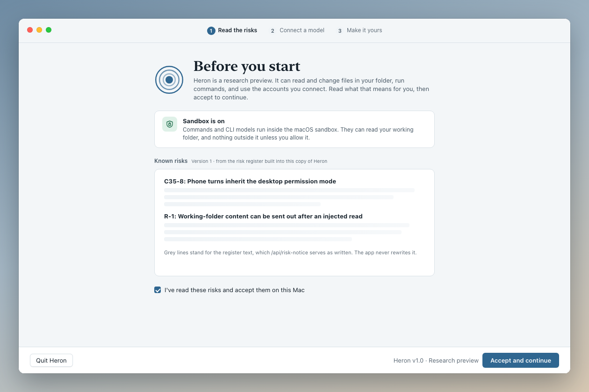

A single-window flow with no sidebar, 1180 × 760, with three steps shown in the title bar: Read the risks, Connect a model, Make it yours.

**Step 1, the risk notice.** This is one of the two snapshot-tested screens, so it is specified exactly.

| Part | Content |
|---|---|
| Hero | The `ripple` avatar at 64 pt, idle. Heading "Before you start" (`large`, serif). Text: "Heron is a research preview. It can read and change files in your folder, run commands, and use the accounts you connect. Read what that means for you, then accept to continue." |
| Sandbox card | As in [The sandbox status on first run](#the-sandbox-status-on-first-run). |
| Label | "Known risks", with "Version *n* · from the risk register built into this copy of Heron" in `ink3`. |
| Risk text | `text` from `GET /api/risk-notice`, rendered as Markdown in a bordered scroll view 230 pt high, focusable so VoiceOver and the keyboard can scroll it. The first entries are C35-8 and R-1. The app shows the text as served and never rewrites it. |
| Checkbox | "I've read these risks and accept them on this Mac". Off by default. |
| Footer | "Quit Heron" on the left. "Heron v1.0 · Research preview", then "Accept and continue" (primary, disabled until the box is ticked) on the right. |

Accepting sends `POST /api/risk-notice {"version": n}`. A `409` means the register changed while the screen was open: reload the text, untick the box, and show "The risk notice was updated. Please read the new version." above it.

When the version goes up after an update, the same screen shows again as a sheet over the main window, with the heading "The risk notice has changed" and the same controls.

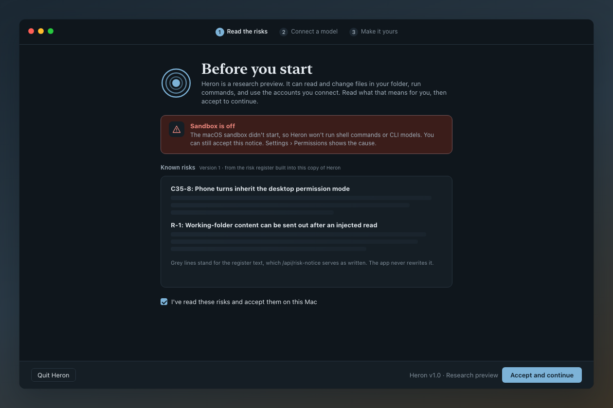

**Step 2, Connect a model.** Heading "Connect a model". Text: "Heron uses an AI app you're already signed in to on this Mac. You won't type a password here." One grouped list from `GET /api/providers`, one row per CLI:

| Provider state | Row |
|---|---|
| Signed in, tested version | Radio enabled; green "Signed in" tag; "Version 2.1.4 · tested"; "Recommended" on the best one |
| Signed out | Radio disabled; red "Signed out" tag; "Codex is signed out. Run `codex login` in Terminal, then check again."; Copy command |
| Untested version | Radio enabled; gold "Untested version" tag; "Version 0.9.2 hasn't been tested with Heron (tested: 0.6 to 0.8)."; Use anyway… |
| Not installed | Radio disabled; "Not installed on this Mac."; How to install |

Below: "Check again" (re-reads `/api/providers`) and "Use an API key instead".

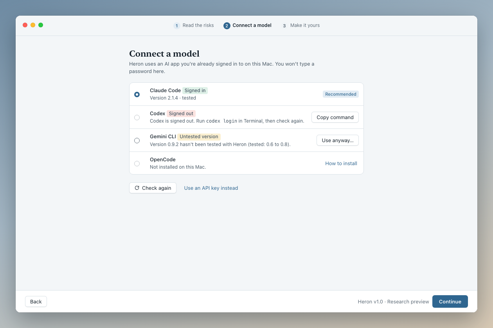

**Step 3, Make it yours.** Name field (saved through `POST /api/persona`), the four avatar styles, the three themes as swatches, and the five accents. Text: "Name your agent and choose how it looks. You can change all of this later in Settings › Appearance." The last button is "Start using Heron", which opens Today.

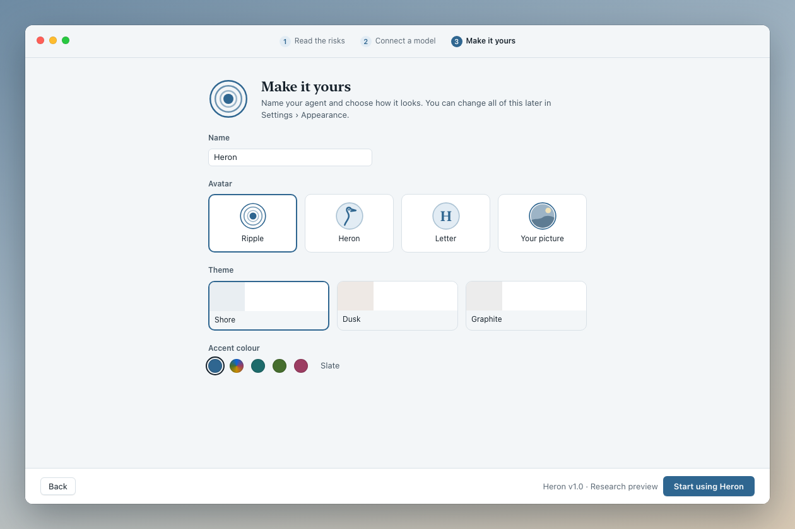

### Today

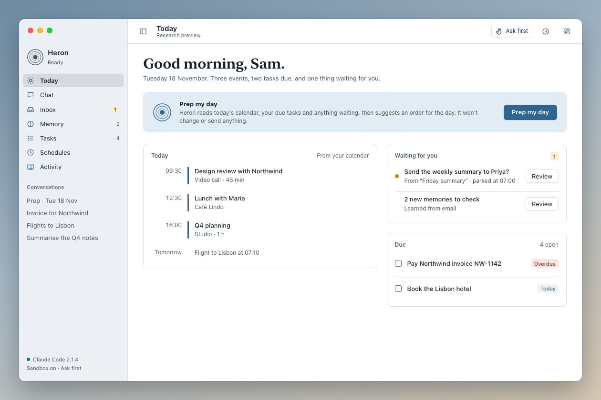

*   **Greeting:** "Good morning, Sam." (`large`, serif), then "Tuesday 18 November. Three events, two tasks due, and one thing waiting for you." The summary sentence is built from counts in `/api/today`, never from the model.
*   **Prep my day card:** the avatar, "Prep my day", the line "Heron reads today's calendar, your due tasks and anything waiting, then suggests an order for the day. It won't change or send anything.", and the primary button.
*   **Two columns:** Today's events (time, title, place) on the left. "Waiting for you" and "Due" panels on the right, each row with one action.
*   **Banners** sit above the content, full width:
    *   another Heron (`background_owner: false`): "Another Heron is running your schedules and phone connection. This window still works as usual." with Learn more;
    *   paused: "Heron is paused. It starts nothing on its own until you resume it. You can still ask it for things." with Resume.

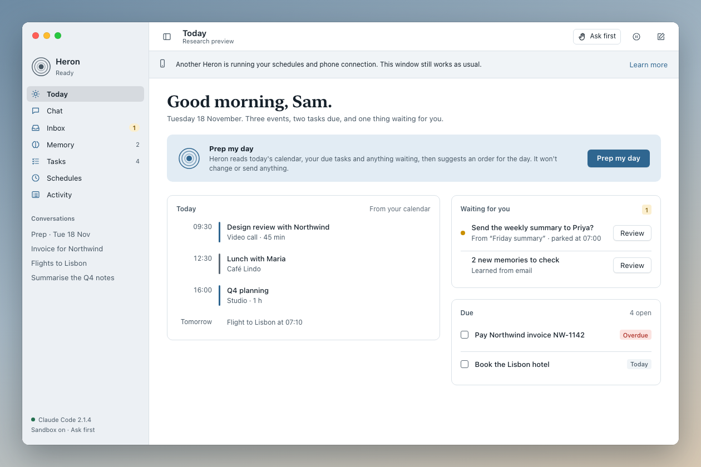

### Chat with live approvals

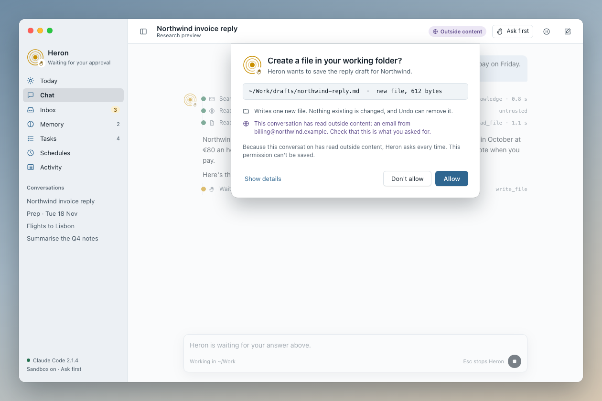

**Thread.** User messages are right-aligned in a `raised` bubble. Replies have no bubble: the avatar sits at the left, and the reply reads like a document at the `reading` size.

**Activity track.** Above and inside each reply, a thin vertical track lists the steps the run took, from `tool_start` and `tool_end` events. Each step has an SF Symbol, a plain sentence ("Read 1 email from billing@northwind.example"), and the tool name and duration in `mono` on the right. Steps that read untrusted content get a violet "Outside content" tag. A step waiting on an approval shows a gold dot and "Waiting for you: …". The track collapses to a one-line summary ("3 steps") once the reply finishes, and expands on click.

**Composer.** At the bottom, `card` radius, with the working folder and "Esc stops Heron" under the field. While a run is going, the send button becomes Stop. While an approval waits, the field says "Heron is waiting for your answer above."

**Toolbar.** When the conversation has read outside content, a violet "Outside content" chip appears, with the tooltip "This conversation has read outside content, so Heron asks before it writes, sends or reads outside your folder."

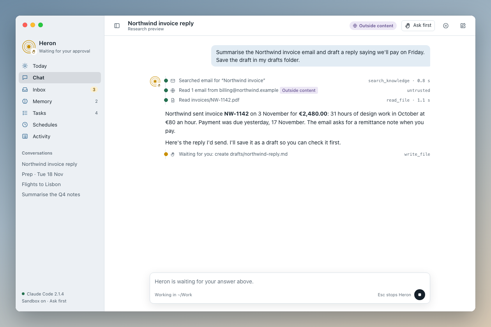

**The approval sheet.** This is the other snapshot-tested screen. An `approval` event for the open conversation shows a window-modal sheet, 520 pt wide. Approvals for other conversations go to the Inbox and the sidebar count.

| Part | Content |
|---|---|
| Header | The avatar (waiting state), a question title (`title2`) built from the action ("Create a file in your working folder?"), and one line of why, from the run ("Heron wants to save the reply draft for Northwind.") |
| Detail | `detail` from the event, in `mono` on `raised`: the path, command, recipient or URL |
| Impact | One or two lines with icons. What changes, and whether it can be undone. When the run is tainted, a violet line: "This conversation has read outside content: an email from billing@northwind.example. Check that this is what you asked for." |
| Scope | Radio group, default "Only this time". "For the rest of this conversation" only when `can_session` is true. "Always in ~/Work/drafts" only when `can_always` is true, labelled from `always_rule`, with "You can remove this in Settings › Permissions." When neither is offered, the group is replaced by one line (below). |
| Footer | "Show details" (raw tool name and arguments) on the left. "Don't allow" and the primary button on the right. |

Rules for the variants. The core decides what can be saved (`src/server.rs:419`, `src/agent.rs:113`): `can_always` is false for high-risk or tainted actions, and `can_session` is false for high-risk actions and for tainted ones other than `web_search`. So a sheet in a conversation that has read outside content usually offers no scope at all, which is the case shown at the top of this section.

*   **Tainted, nothing can be saved:** the scope group is replaced by "Because this conversation has read outside content, Heron asks every time. This permission can't be saved." The violet impact line names the outside content.
*   **Clean, everything offered:** all three scope rows, as in the screenshot below.
*   **`can_session` and `can_always` both false for another reason:** the scope group is hidden and the sheet just asks. The states mock shows the unavailable rows as "Not offered for this action" for reference only.
*   **`risk` high** (sends, deletes, spends, can't be undone): a red "Can't be undone" tag next to the title. The primary button names the action ("Send", "Delete"), never just "Allow". "Don't allow" is the default button, so Return doesn't approve.
*   **Normal risk:** "Allow" is the default button.
*   **Answered elsewhere** (`approval_resolved` from the phone or another window): the sheet closes by itself and the thread shows "Answered from your phone" for 3 seconds.
*   **Parked** (`approval_parked`, nobody answered in time): the sheet closes, the step shows "Moved to your Inbox", and the item appears under Waiting for you.

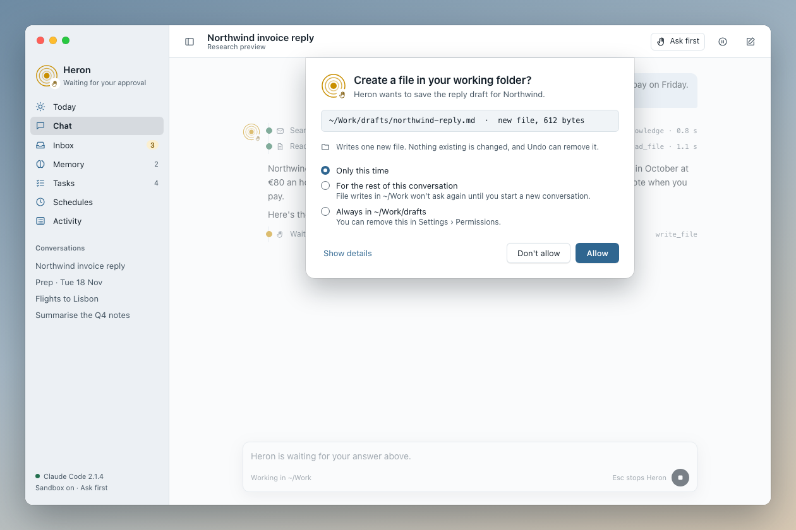

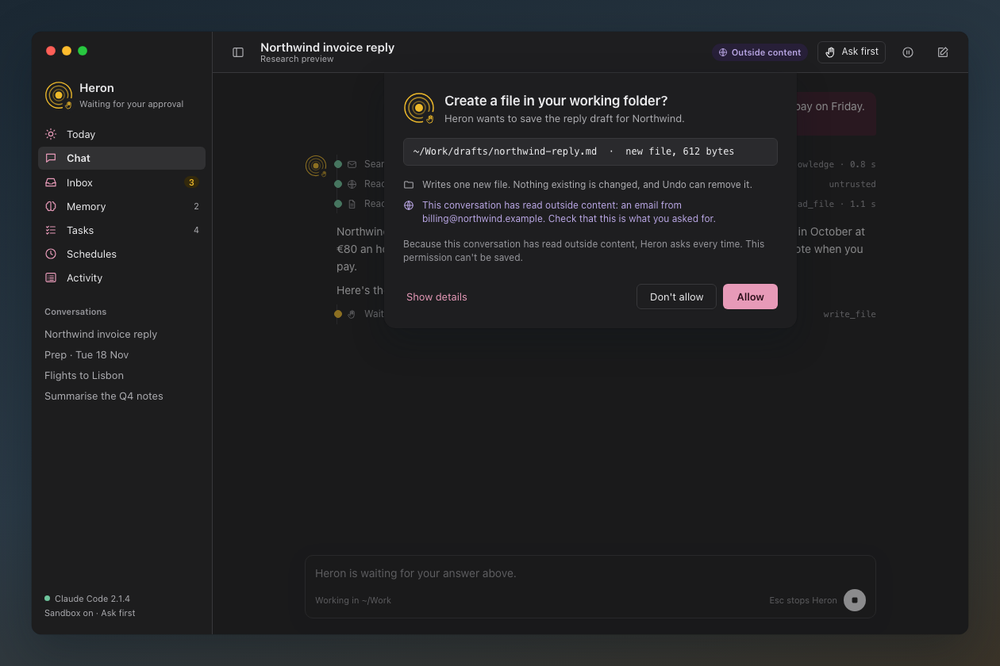

### Inbox

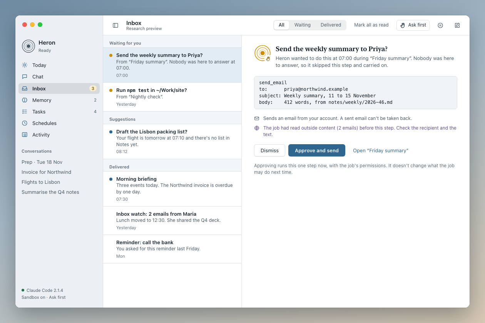

Three columns: sidebar, list (360 pt), detail. Filter control in the toolbar: All, Waiting, Delivered, plus "Mark all as read".

*   **List sections:** Waiting for you (gold dot), Suggestions (accent dot when unread), Delivered (accent dot when unread). Each row: bold title, one-line summary, time.
*   **Parked approval detail:** title as a question; "Heron wanted to do this at 07:00 during “Friday summary”. Nobody was here to answer, so it skipped this step and carried on."; the detail block; impact lines; then Dismiss, "Approve and send" (named after the action) and "Open “Friday summary”". Under it: "Approving runs this one step now, with the job's permissions. It doesn't change what the job may do next time." Parked approvals offer approve or dismiss only, no scope.

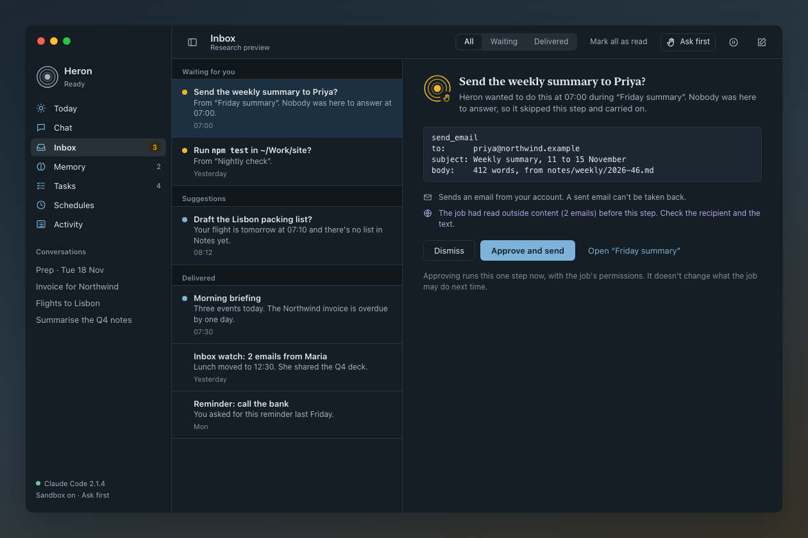

### Memory

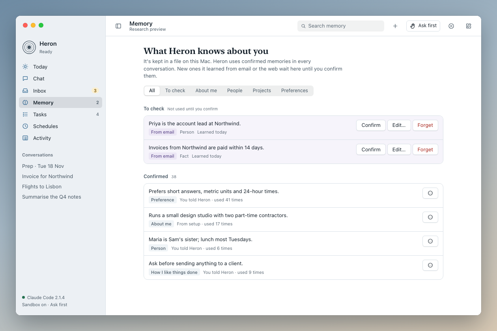

*   **Heading:** "What Heron knows about you" (serif), then "It's kept in a file on this Mac. Heron uses confirmed memories in every conversation. New ones it learned from email or the web wait here until you confirm them."
*   **Filter:** All, To check, About me, People, Projects, Preferences. Search with ⌘F.
*   **To check:** memories learned from untrusted sources, marked "Not used until you confirm", each with its source ("From email"), kind and age, and Confirm, Edit… and Forget.
*   **Confirmed:** with source and use count ("You told Heron · used 41 times"). Edit inline; Forget retires it, with Undo in a toast for 5 seconds.

### Tasks and Schedules

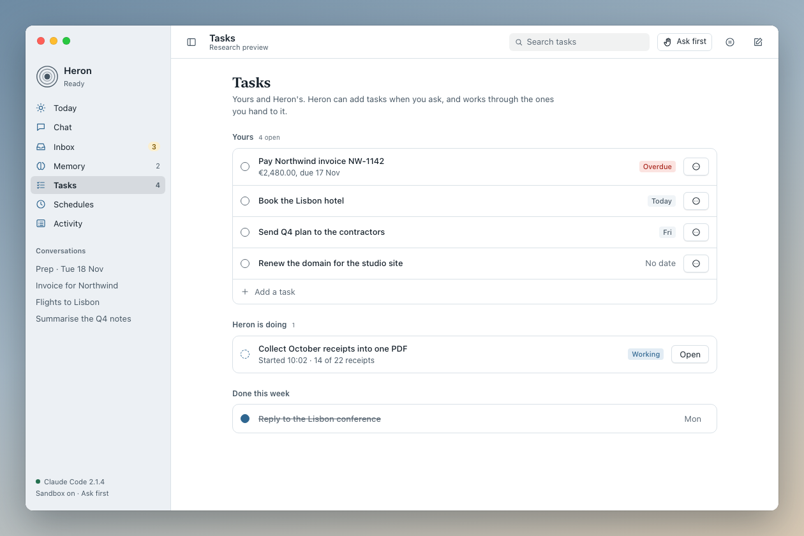

**Tasks:** "Yours" (checkbox, title, amount or note, due tag: red Overdue, Today, weekday or No date), "Heron is doing" (progress text such as "14 of 22 receipts", Working tag, Open), "Done this week" (struck through, collapsed by default). "Add a task" row at the end of Yours.

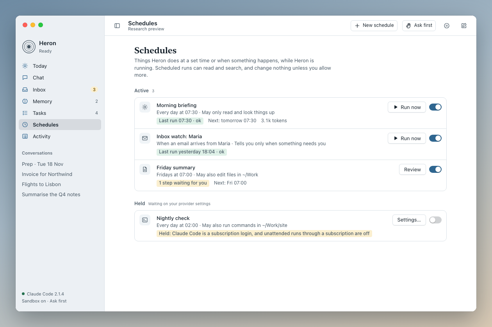

**Schedules:** intro "Things Heron does at a set time or when something happens, while Heron is running. Scheduled runs can read and search, and change nothing unless you allow more." Then "Active" and "Held" groups. Each row: name, trigger and what it may do ("Every day at 07:30 · May only read and look things up"), last and next run, token use, and one action (Run now, Review, Settings…). A held row says why in one line: "Held: Claude Code is a subscription login, and unattended runs through a subscription are off."

### Activity

Not mocked. It reuses the Schedules list pattern: one row per audit entry with time, the action as a sentence, the provider and CLI version (M9), and the decision (allowed by mode, allowed by grant, approved, refused). A toolbar filter picks All, Changes, Refused. The empty state is "No activity yet. Every action Heron takes is listed here, with who allowed it."

### Settings

The standard `Settings` scene, 720 pt wide, with toolbar tabs.

| Tab | Holds |
|---|---|
| General | Working folder, launch at login, the menu bar extra on/off, phone connection |
| Heron | Name and personality (`/api/persona`), and "Getting to know you" questions |
| Appearance | Avatar, theme, accent colour, light/dark, text size |
| Model | Providers with version status, unattended work switch |
| Permissions | Sandbox status, permission mode, grants with Remove, `rule_notices` |
| Connections | Email, calendar and other sources, and the Awareness switches |
| Usage | Tokens by day and model, from `/api/usage` |

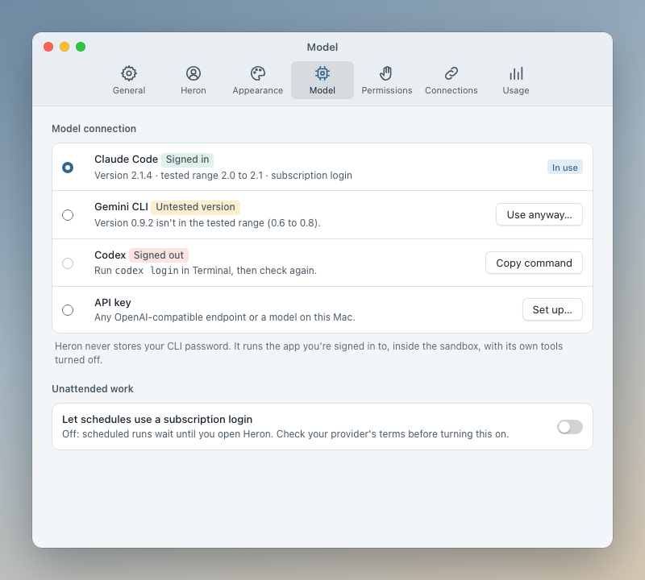

**Model** lists each provider: "Claude Code · Signed in · Version 2.1.4 · tested range 2.0 to 2.1 · subscription login · In use". Untested and signed-out rows follow the first-run wording. Under the list: "Heron never stores your CLI password. It runs the app you're signed in to, inside the sandbox, with its own tools turned off." Then the unattended-work switch: "Let schedules use a subscription login. Off: scheduled runs wait until you open Heron. Check your provider's terms before turning this on."

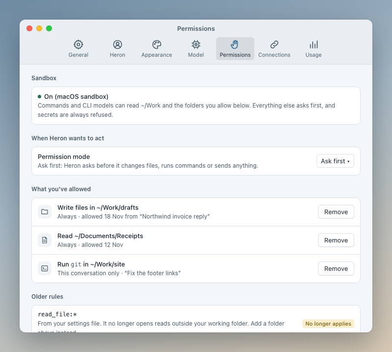

**Permissions:** the sandbox card ("On (macOS sandbox). Commands and CLI models can read ~/Work and the folders you allow below. Everything else asks first, and secrets are always refused."), the permission mode picker with a sentence for the current mode, "What you've allowed" (each grant as a sentence, with scope, date, source conversation and Remove), and "Older rules" for `rule_notices` ("read_file:\*. From your settings file. It no longer opens reads outside your working folder. Add a folder above instead." with a "No longer applies" tag).

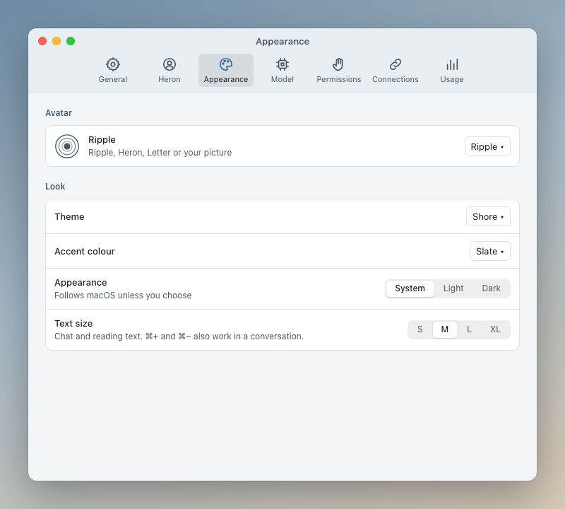

### Where the Slint-only screens go

*   **Awareness:** its suggestions appear in the Inbox; its on/off switches move to Settings › Connections.
*   **Usage:** Settings › Usage.
*   **Getting to know you:** Settings › Heron, and the Memory empty state's "Tell Heron about you" button opens it.
*   **Reminders:** reminders are tasks with a time, so they appear in Tasks with their time, and as Delivered items in the Inbox when they fire.

### Menu bar extra

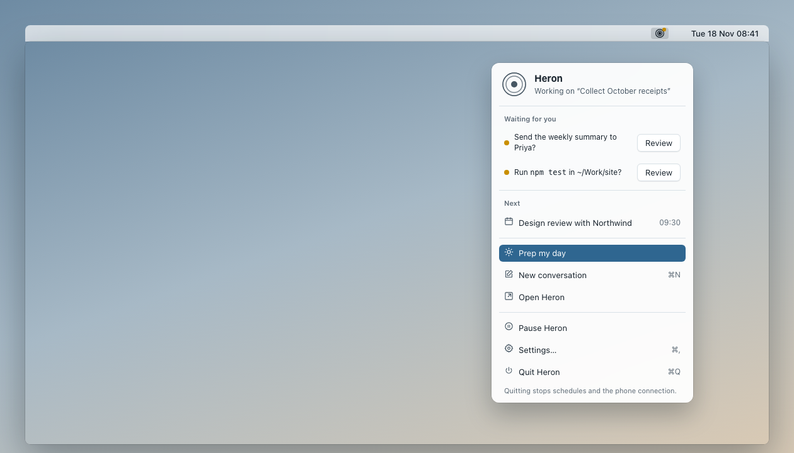

As in [The menu bar extra](#the-menu-bar-extra).

## Empty, loading and error states

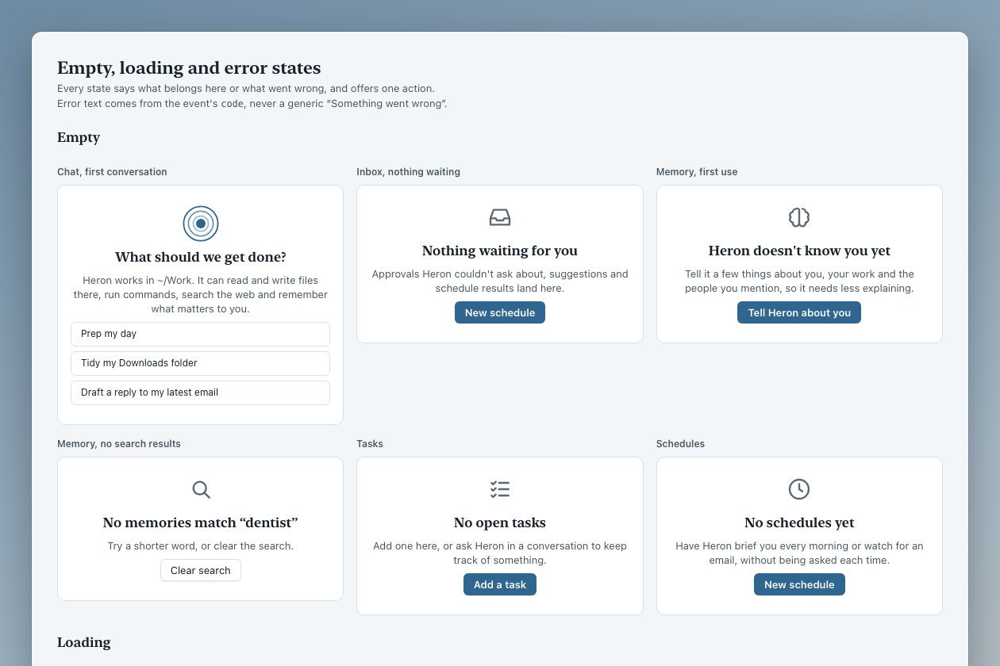

Every state says what belongs here or what went wrong, and offers one action. Error text comes from the event's `code`, never a generic "Something went wrong".

### Empty

| Where | Title (serif) | Text | Action |
|---|---|---|---|
| Chat, first conversation | What should we get done? | Heron works in ~/Work. It can read and write files there, run commands, search the web and remember what matters to you. | Three starter chips: Prep my day; Tidy my Downloads folder; Draft a reply to my latest email |
| Inbox | Nothing waiting for you | Approvals Heron couldn't ask about, suggestions and schedule results land here. | New schedule |
| Memory, first use | Heron doesn't know you yet | Tell it a few things about you, your work and the people you mention, so it needs less explaining. | Tell Heron about you |
| Memory, no results | No memories match “dentist” | Try a shorter word, or clear the search. | Clear search |
| Tasks | No open tasks | Add one here, or ask Heron in a conversation to keep track of something. | Add a task |
| Schedules | No schedules yet | Have Heron brief you every morning or watch for an email, without being asked each time. | New schedule |
| Activity | No activity yet | Every action Heron takes is listed here, with who allowed it. | None |

### Loading

*   **Starting the core:** nothing for the first 2 seconds, then the avatar (thinking) with "Starting Heron…" and "This usually takes a second or two."
*   **Lists:** nothing for the first 300 ms, then skeleton rows in `raised`. No spinner for lists.
*   **A reply:** between `session` and the first `text`, the avatar thinks and the latest step shows in the track ("Reading your calendar…" with `upcoming_events`). With no step yet: "Thinking. Esc stops Heron."

### Errors and blocked states

| Case | Signal | Title | Text | Actions |
|---|---|---|---|---|
| CLI logged out (CUJ 5) | `error`, provider logged out | Claude Code is logged out | Run `claude auth login` in Terminal, then send your message again. | Copy command; Try again |
| Untested CLI version | `cli_version_untested` | Untested version 3.0.1 of Claude Code | Heron is tested with 2.0 to 2.1. Nothing ran. Continue with 3.0.1, or go back to a tested version. | Continue with 3.0.1; Model settings |
| Core stopped twice | `CoreProcess` gave up | Heron's core stopped | It stopped again within a minute of restarting, so Heron isn't trying again on its own. Your conversations and settings are safe. | Restart Heron's core; Copy details |
| Core restarted once | `CoreProcess` restarted | (banner) Heron restarted its core. If a reply was cut off, send it again. | | Dismiss |
| Conversation busy | `session_busy` | Heron is still working on this conversation | Your message is kept in the box. Send it when Heron finishes, or stop the current reply. | Stop the current reply |
| Protected folder | `workspace_refused` | Heron can't work in ~/Library/Keychains | That folder holds secrets, so Heron refuses it in every mode. Choose another working folder. | Choose folder… |
| Sandbox off (Q11) | `sandbox: false` | Commands are off: the sandbox isn't running | Heron won't run shell commands or CLI models without the macOS sandbox. Chat with an API-key model still works. | Show the cause |
| Risk notice not accepted | `428 risk_notice_not_accepted` | (opens the risk notice sheet) | | |
| Another Heron running | `background_owner: false` | (banner on Today) | Another Heron is running your schedules and phone connection. This window still works as usual. | Learn more |

Errors in a reply appear inline under the reply as a `dangerSoft` card with the title, text and actions above. The avatar goes to `error` and back to `idle` after 5 seconds, as §4 says.

## Accessibility

*   Every control is a native control or has an `accessibilityLabel`. Icon-only toolbar buttons have labels ("Pause Heron", "New conversation") and tooltips.
*   The approval sheet's title is announced when it opens, and focus starts on the scope group (or on "Don't allow" when there is no scope).
*   The activity track is a list with the label "Steps Heron took". Each step reads as its sentence, then its status.
*   Colour is never the only signal: waiting has a badge and the word "Waiting", outside content has the globe and the words "Outside content", errors have the triangle.
*   Full keyboard use: every action in this doc has a keyboard path, and the menu bar extra opens with a global shortcut only if the user sets one.
*   Reduce Motion and Increase Contrast as specified above. Reduce Transparency replaces the sidebar material with the solid `sidebar` colour.

## Decisions

Recommendations first. The owner's answers are recorded here before U4 starts.

| # | Choice | Recommendation | Alternatives | Owner's answer |
|---|---|---|---|---|
| D1 | Overall direction | Calm, native, Shore + Slate, serif only for display | — | Pending |
| D2 | Inbox scope | One Inbox: parked approvals, suggestions and delivered results | Approvals feed only, named "Approvals" | Pending |
| D3 | Themes | Shore (default), Dusk, Graphite | Shore only in v1 | Pending |
| D4 | Default accent | `slate` | `system` | Pending |
| D5 | Default avatar | `ripple` | `heron` | Pending |
| D6 | "Prep my day" prompt | As written above, acts on nothing | Let it also draft replies and tasks, with approvals | Pending |
| D7 | Menu bar extra | Status, waiting items, next event, actions | Status and Open Heron only | Pending |
| D8 | Sandbox on first run | Status card above the risk text | Inline sentence in the risk text heading | Pending |

## Verification

This doc changes no code, so the checks are visual and are done by U4:

*   U4's snapshot tests for the risk notice and the approval sheet compare against the layouts in this doc, in light and dark, Shore theme, Slate accent.
*   `tokens.json` is the only source of colour values. A test in `HeronUITests` checks the Swift theme values against it, and re-runs the contrast table (all text ≥ 4.5:1).
*   The owner reviews U4's screenshots against the mockups in the second pull request, under Q7.

No evaluator is added, so `genesis audit` doesn't apply. testteeth applies to U4's tests, as in the v1 doc.

## Work units

No new work units. U4's existing row in `heron-v1.md` builds this direction; its check is unchanged.

| id | what to build | scope | depends on | check | model role |
|---|---|---|---|---|---|
| U4 (existing) | SwiftUI Mac app, following this doc | `macos/**` | Ut | `swift build --package-path macos/HeronMac && swift test --package-path macos/HeronMac && grep -qx '.build/' macos/HeronMac/.gitignore && test -s macos/HeronMac/DESIGN-CHOICES.md` | feature, refactoring: sonnet high |

**For the build:** skein worktrees don't pick up commits made after a node starts. This doc and its mockups must be on `feat/heron-v1` before the U4 node starts, and U4's `--context` should name `docs/designs/heron-mac-visual.md`.
